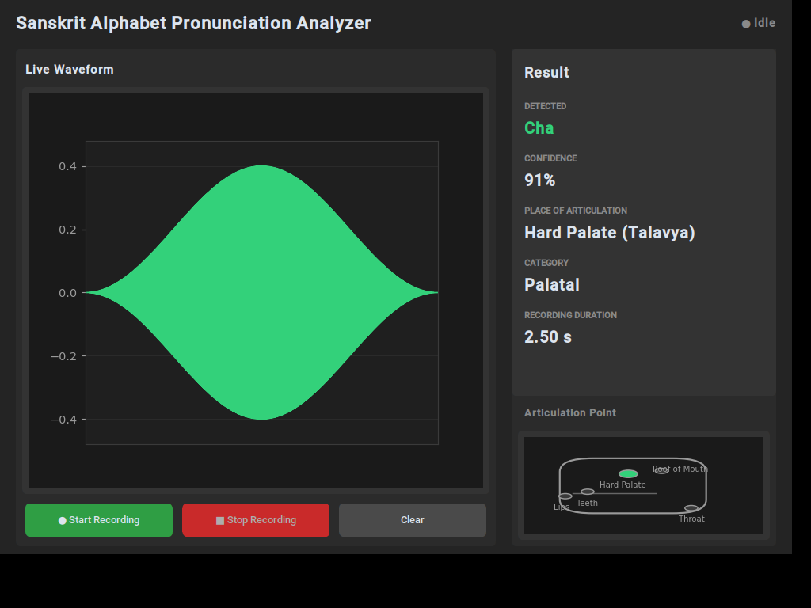

# Sanskrit Alphabet Pronunciation Analyzer

A desktop application that listens to you speak a Sanskrit alphabet (e.g. *Ka*, *Cha*, *Pa*), detects which one you said, and shows **where in the mouth/throat it is produced** — complete with a live waveform display and a visual articulation-point diagram.

Built with **CustomTkinter** (modern dark-themed GUI), **sounddevice** (microphone capture), and **matplotlib** (live waveform + articulation diagram). The speech-recognition backend is designed to be swapped for a real ML model (Whisper, Vosk, Wav2Vec2, or a custom TensorFlow classifier) later without touching a single line of GUI code.



---

## Features

- 🎙️ **Live microphone recording** (~2.5s) with real-time waveform visualization
- 🔤 **Detects 27 Sanskrit alphabets** — Ka through Ha, including retroflex/dental groups, semi-vowels, and sibilants
- 📍 **Shows the place of articulation** (Kanthya/Throat, Talavya/Palate, Murdhanya/Roof of Mouth, Dantya/Teeth, Oshthya/Lips) sourced from `data/articulation.json`
- 🫁 **Visual mouth/throat diagram** that highlights the correct articulation point for the detected sound
- 📊 **Confidence score** for every detection
- 🧩 **Pluggable recognition backend** — starts with lightweight keyword matching, structured so Whisper/Vosk/Wav2Vec2/TensorFlow can be dropped in later
- 🪵 Full logging (console + `logs/app.log`) and typed, documented, exception-safe code throughout

---

## Project Structure

```
sanskrit-pronunciation-analyzer/
├── app.py                        # Application entry point
├── requirements.txt
├── README.md
│
├── gui/                          # Presentation layer (CustomTkinter)
│   ├── main_window.py            # Root window; wires audio + recognition + widgets together
│   ├── waveform_widget.py        # Live + static waveform display (matplotlib)
│   ├── articulation_widget.py    # Mouth/throat diagram with highlightable regions
│   └── result_panel.py           # Detected alphabet / confidence / place-of-articulation panel
│
├── audio/                        # Audio capture layer
│   └── recorder.py               # AudioRecorder: sounddevice-based mic capture, live queue + full buffer
│
├── recognition/                  # Speech-recognition layer (pluggable)
│   ├── base_recognizer.py        # Abstract BaseRecognizer interface + RecognitionResult
│   ├── keyword_recognizer.py     # Default backend: online transcription + fuzzy keyword matching
│   ├── future_backends.py        # Stub classes for Whisper / Vosk / Wav2Vec2 / TensorFlow
│   └── recognizer_factory.py     # Builds the active backend from config — GUI never imports a backend directly
│
├── utils/                        # Shared utilities
│   ├── config.py                 # Centralized typed configuration (audio, recognition, UI)
│   ├── logger.py                 # Console + file logging setup
│   └── articulation_repository.py# Loads/serves data/articulation.json
│
├── data/
│   └── articulation.json         # Place-of-articulation mapping for all 27 alphabets
│
├── assets/                       # Static assets (screenshots, optional custom icons)
└── logs/                         # Runtime log files (created automatically)
```

This separation means each layer only depends on the ones below it (`gui` → `recognition`/`audio`/`utils`, never the reverse), so any layer can be replaced independently — e.g. swap the entire recognition engine, or restyle the whole GUI, without breaking the others.

---

## Installation

**Requirements:** Python 3.9+ and a working microphone.

1. **Clone / unzip the project**, then move into its folder:
   ```bash
   cd sanskrit-pronunciation-analyzer
   ```

2. **Create a virtual environment (recommended):**
   ```bash
   python -m venv venv
   source venv/bin/activate        # Windows: venv\Scripts\activate
   ```

3. **Install dependencies:**
   ```bash
   pip install -r requirements.txt
   ```

   > **Note on PyAudio:** `SpeechRecognition`'s microphone support pulls in PyAudio, which sometimes needs system-level audio headers.
   > - **Windows:** `pip install pyaudio` usually works directly, or use `pip install pipwin && pipwin install pyaudio` if it fails.
   > - **macOS:** `brew install portaudio` first, then `pip install pyaudio`.
   > - **Linux:** `sudo apt-get install portaudio19-dev python3-dev` first, then `pip install pyaudio`.
   >
   > This app's actual recording uses `sounddevice`, not PyAudio directly — PyAudio is only needed by the `SpeechRecognition` library's `AudioData` handling used in `recognition/keyword_recognizer.py`.

---

## Running the App

```bash
python app.py
```

A dark-themed ~1000×700 window opens with:

1. **Live Waveform** panel (left) with **Start Recording / Stop Recording / Clear** buttons
2. **Result** panel (top right) showing Detected Alphabet, Confidence %, Place of Articulation, Category, and Recording Duration
3. **Articulation Point** diagram (bottom right) that highlights throat / palate / roof of mouth / teeth / lips

### How to use it
1. Click **Start Recording**.
2. Clearly speak a single Sanskrit alphabet (e.g. *"Ka"*, *"Cha"*, *"Pa"*) into your microphone. Recording auto-stops after ~2.5 seconds (or click **Stop Recording** manually).
3. The waveform freezes and stays visible; after a moment, the Result panel and articulation diagram update with the detection.
4. Click **Clear** to reset everything and try again.

The default recognizer needs an internet connection (it uses the Google Web Speech API via the `SpeechRecognition` library for transcription, then fuzzy-matches the transcript against known phonetic spellings). If you're offline or the mic isn't confidently understood, the app will report "Not recognized" rather than guessing — see [Extending the Recognition Engine](#extending-the-recognition-engine) to switch to a fully offline backend.

---

## Data: Place of Articulation

`data/articulation.json` holds the linguistic mapping used throughout the app, e.g.:

```json
"Cha": {
  "place": "Hard Palate (Talavya)",
  "sanskrit_term": "Talavya",
  "category": "Palatal",
  "highlight_region": "palate",
  "description": "Produced with the tongue touching the hard palate."
}
```

| Group | Alphabets | Place of Articulation |
|---|---|---|
| Guttural | Ka, Kha, Ga, Gha, Nga | Throat (Kanthya) |
| Palatal | Cha, Chha, Ja, Jha, Nya | Hard Palate (Talavya) |
| Retroflex | Ta, Tha, Da, Dha, Na | Roof of Mouth (Murdhanya) |
| Labial | Pa, Pha, Ba, Bha, Ma | Lips (Oshthya) |
| Semi-vowels | Ya, Ra, La, Va | Palate / Roof / Teeth / Teeth+Lips |
| Fricatives/Sibilants | Sha, Sa, Ha | Palate / Teeth / Throat |

Edit this JSON file to correct or extend the mapping — the app picks up changes automatically on next launch.

---

## Extending the Recognition Engine

The recognition layer is built around a simple contract so it can grow from "keyword matching" into a real ML model without touching the GUI:

```python
class BaseRecognizer(ABC):
    @abstractmethod
    def recognize(self, samples: np.ndarray, sample_rate: int) -> RecognitionResult:
        ...
```

To add a new backend (e.g. Whisper):

1. Implement it in `recognition/future_backends.py` (stub classes with implementation sketches are already there for **Whisper**, **Vosk**, **Wav2Vec2**, and **TensorFlow**).
2. It's already registered in `recognition/recognizer_factory.py`'s `BACKEND_REGISTRY`.
3. Switch the active backend in `utils/config.py`:
   ```python
   backend: str = "whisper"   # was "keyword"
   ```
4. Run the app — nothing in `gui/` needs to change.

This is the same pattern a final-year project can point to as evidence of clean, extensible architecture.

---

## Optional Enhancement: Articulation Diagram

`gui/articulation_widget.py` draws a simplified side-profile mouth/throat diagram procedurally with matplotlib (no external image files needed) and highlights the correct region based on `highlight_region` in `articulation.json`:

- **Ka** → highlights **Throat**
- **Cha** → highlights **Hard Palate**
- **Pa** → highlights **Lips**

---

## Code Quality

- Classes throughout (`AudioRecorder`, `BaseRecognizer`, `ArticulationRepository`, `WaveformWidget`, etc.) with clear single responsibilities
- Type hints on all public methods
- Exception handling around microphone access, audio streaming, JSON parsing, and network transcription
- Centralized logging to console and `logs/app.log`
- Centralized, typed configuration in `utils/config.py` (no magic numbers scattered through the code)
- Threading used correctly: audio capture happens on sounddevice's own thread, recognition runs on a background thread, and both are marshalled back to the GUI thread safely via `tkinter.after`

---

## Troubleshooting

| Problem | Likely fix |
|---|---|
| "Microphone error" on Start Recording | Check OS microphone permissions and that a mic is connected; run `python -c "from audio.recorder import AudioRecorder; print(AudioRecorder.list_input_devices())"` to list detected devices. |
| Always shows "Not recognized" | Check your internet connection (default backend needs it), speak closer to the mic, reduce background noise, or switch to an offline backend (see above). |
| `PyAudio` fails to install | See the OS-specific notes under [Installation](#installation). |
| Window looks tiny/huge | Resize normally — `UIConfig.window_size` in `utils/config.py` controls the default. |

---

## License

This project is provided as an educational/final-year mini-project template. Feel free to adapt it.
